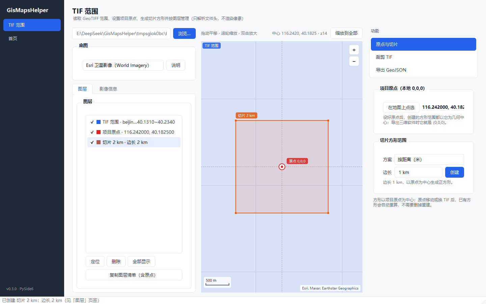
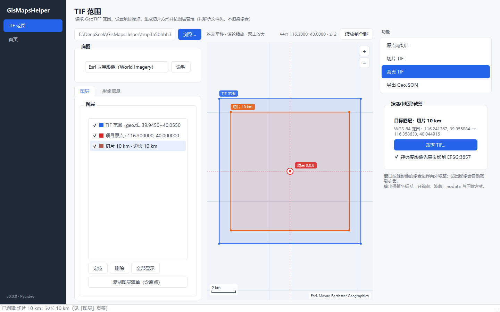
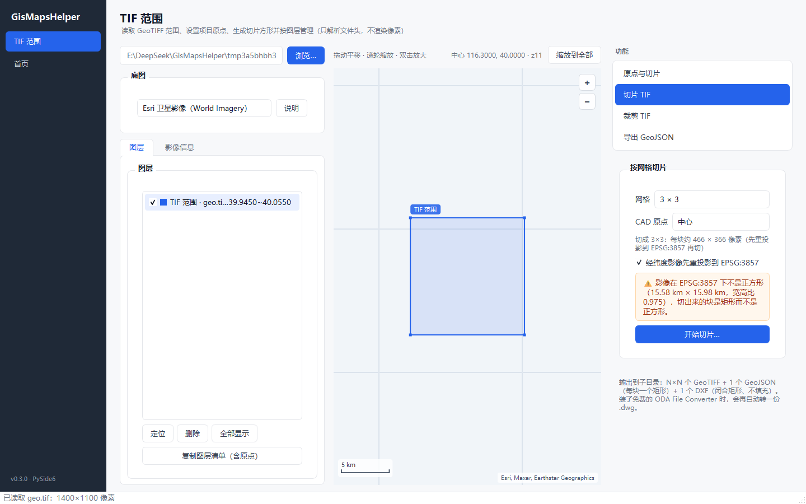
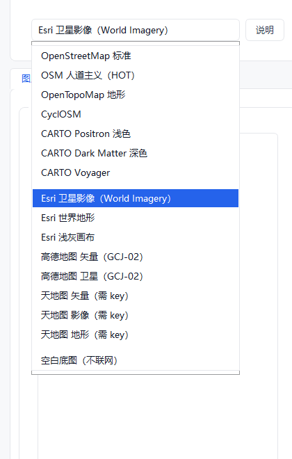

# GisMapsHelper

GIS 地图处理工具。界面用 **PySide6**，当前版本 **v0.3.0**：第一个业务页「TIF 范围」已经能用——
选择本地 GeoTIFF，只读文件头拿到矩形范围与基本信息，叠加到在线底图，并可在图上标定项目原点、
生成两种规格的切片方形、按图层管理。

## 能做什么

- **只读范围，不碰像素**：纯标准库解析 TIFF / BigTIFF 头，几十 GB 的影像也是秒开；
- **矩形落图**：原生瓦片地图控件（拖动、滚轮缩放到光标、双击放大），支持 15 个免费 / 开源底图；
- **项目原点**：在地图上点一下，把这个位置当作本地坐标 `0,0,0`，供三维软件导入使用；
- **两种切片方形**：按地面距离（1 / 2 / 5 / 10 km，可自定义）或按 TIF 像素（1024 ~ 16384 px，可自定义），
  原点可落在矩形中心或四角（默认中心）；
- **按网格切片**：2×2 / 3×3 / 6×6 / 9×9 切成 N×N 块 GeoTIFF，同时出一个 GeoJSON（每块一个矩形）
  和一个 CAD 文件（闭合矩形、不填充）；影像在 3857 下不是正方形时会先提示；
- **图层管理**：TIF 代理矩形、项目原点、后续创建的切片方形都在左侧图层里，可勾选显隐、定位、删除；
- **按图层裁剪 TIF**：选中切片方形 → 一键裁出一块新的 GeoTIFF，坐标系、地理参考、分辨率、压缩方式
  全部沿用源文件（分块读写，大图不会一次性进内存）；
- **导出 GeoJSON**：把**全部图层**一键写进同一个 GeoJSON（矩形为 `Polygon`、原点为 `Point`），
  底图是 GCJ-02 时会先问一句用哪个基准，避免导出的面悄悄偏几百米；
- **信息一屏看清**：尺寸、波段、位深、压缩、坐标系、经纬度范围、中心点、面积、投影 / 实地分辨率、原生层级；
- **GCJ-02 自动校正**：切到高德 / 腾讯系底图时，原点与矩形会自动换算，不会莫名偏 500 米；
- **命令行也能看**：`--inspect` 直接打印同一份信息，不启动界面。



## 环境

| 项目 | 值 |
| --- | --- |
| Python | 3.13（`C:\Users\Administrator\AppData\Local\Programs\Python\Python313`） |
| 虚拟环境 | `.venv/`（项目根目录） |
| 解释器 | `.venv\Scripts\python.exe` |
| 界面框架 | PySide6 6.12 |
| 栅格读写 | rasterio 1.5 + numpy（自带 GDAL / PROJ，**不用**另装 OSGeo4W 或 QGIS） |

`rasterio` 只有裁剪功能用得到：读图像范围时仍然只解析文件头，纯标准库、几十 GB 也是秒开。
如果只做范围核对、不裁剪，可以不装它（裁剪按钮会自动置灰）。

## 运行

```powershell
# 启动界面
.\.venv\Scripts\python.exe -m gismapshelper

# 只读文件头，打印一个 GeoTIFF 的基本信息（不启动界面）
.\.venv\Scripts\python.exe -m gismapshelper --inspect "D:\data\beijing.tif"

# 其他
.\.venv\Scripts\python.exe -m gismapshelper --env
.\.venv\Scripts\python.exe -m gismapshelper --version
```

VS Code 里按 **F5** 即可运行（[launch.json](.vscode/launch.json) 已按模块配好）。

> 注意：不要直接 `python src\gismapshelper\app.py`，文件被当作脚本执行时没有父包，会报 `attempted relative import with no known parent package`。

换一台电脑从零部署（含离线安装、自检清单与常见问题）见 **[docs/deploy.md](docs/deploy.md)**。

## TIF 范围页

界面分三栏：**左**「图层 / 影像信息」页签，**中**地图，**右**功能区（上方是功能菜单，下方是
所选功能的详细面板）。右栏当前有三项：**原点与切片**、**裁剪 TIF**、**导出 GeoJSON**。

1. 点「浏览…」或把 `.tif` 直接拖进窗口，地图自动缩放到影像范围；
2. 右栏功能菜单选「原点与切片」，点 **在地图上点选**，再在底图上点一下，就设好了项目原点（本地 `0,0,0`）；
   Esc 可取消，原点坐标显示在按钮右侧；
3. 选择切片方案与边长，点「创建」：
   - **按距离（米）**：1 km / 2 km / 5 km / 10 km，也可以直接输入 `3500`、`3.5 km`；
   - **按 TIF 像素**：1024 / 2048 / 4096 / 8192 / 16384 px，也可以输入任意像素数；
     边长 = 像素数 × TIF 投影分辨率 × cos(原点纬度)，提示行会实时显示换算结果；
4. 每个方形都会成为一个图层，和 TIF 代理矩形、项目原点一起列在左侧「图层」页签里：
   勾选框控制显隐，双击或「定位」缩放到该层，「删除」移除，坐标与边长写在条目里；
5. 左侧「影像信息」页签列出文件大小、像素尺寸、波段 / 位深、压缩方式、坐标系及其来源、原始范围、
   经纬度范围、中心点、覆盖面积、投影 / 实地分辨率、原生层级、建议切片层级；
6. 顶部下拉框可换底图；需要 tk 的天地图会多出一个输入框（key 记在本机注册表）；
7. 在「图层」里选中一个切片方形 → 右栏切到「裁剪 TIF」（面板会显示目标图层与 WGS-84 范围）
   → 点「裁剪 TIF…」，坐标基准、地理参考、分辨率、压缩方式都跟源文件一致，直接拖进 QGIS / 三维软件就能对齐。

裁剪规则：

- 窗口按源影像的像素边界**向外取整**，所以结果可能比切片范围大不到一个像素（10 m/px 的图最多多 10 m）；
- 请求的是正方形（3857 米制下宽高相等）时，会把像素窗口凑成**严格方形**，不会出现 1042 × 1043 这种 1 像素差；
- 切片超出影像时自动裁到交集边界，状态栏会提示「已裁到边界」；完全没交集则直接报错、不写文件；
- 输出默认叫 `<源文件名>_<图层名>.tif`，放在源文件旁边；已有同名文件会先问要不要覆盖；
- 输出保留波段数、数据类型、`nodata`、压缩方式（源文件是 LZW 就还是 LZW），超大影像自动用 BigTIFF；
- 只支持**矩形**裁剪；按多边形裁剪要上 `rasterio.mask`，等有需求再加。

### 经纬度影像为什么裁出来是长方形

「10 km」指的是**地面**距离。源影像是 EPSG:4326（经纬度）时，10 km 在经度方向只占 0.117°、
纬度方向占 0.090°，所以文件里是 1174 × 900 的像素块——地面是方的，文件看着是长的
（宽高比恰好是 `1 / cos(纬度)`）。

勾选面板里的 **「经纬度影像先重投影到 EPSG:3857」**（默认开）就会先转成 Web 墨卡托再裁：

| 源影像 | 是否重投影 | 输出 |
|---|---|---|
| EPSG:4326 | 否 | 1174 × 900 px（宽高比 1.304） |
| EPSG:4326 | **是** | **1043 × 1043 px**，12.54 m/px 方像素块 |

代价是重采样一次（像素值会被插值，默认 cubic）。源影像本来就是 3857 时这个勾选不起作用。



## 按网格切片（切片 TIF）

右栏「切片 TIF」把当前 TIF 等分成 N×N 块（2×2 / 3×3 / 6×6 / 9×9），选输出目录后一次产出三样东西：



```
<输出目录>/<影像名>_3x3/
├─ <影像名>_r1c1.tif … <影像名>_r3c3.tif    # 9 块带地理参考的 GeoTIFF
├─ <影像名>_3x3.geojson                     # 9 个 Polygon，每块一个
└─ <影像名>_3x3.dxf                         # 9 个闭合矩形，不填充
```

- 网格边界按**像素**等分，N 除不尽时各块差 1 像素，但绝不重叠、也不漏；
- 面板会提示「影像在 EPSG:3857 下不是正方形（3.00 km × 2.00 km，宽高比 1.500）」
  —— N×N 切的是整幅影像，影像本身不方，格子就一定是矩形；要正方形请先裁成正方形再切；
- 经纬度影像（EPSG:4326）可以勾选「先重投影到 EPSG:3857」再切，输出的块是米制坐标，
  直接进 CAD / 三维软件不用再换算；
- 每块都保留坐标系、分辨率、波段、`nodata` 与压缩方式，可直接拖进 QGIS / 三维软件。

### CAD 文件与原点

「CAD 原点」决定 DXF/DWG 里 `(0,0)` 落在影像的什么位置，默认**中心**，也可选左上 / 右上 / 左下 / 右下。
矩形坐标是以该点为 (0,0) 的**地面米**（和「复制图层清单」里的 `local_offsets_m` 口径一致），
所以 `中心` 时坐标是对称的：

```
DXF 矩形数: 9 | 闭合: True
DXF 坐标范围: x -1145.2~1145.2  y -763.5~763.5（米，以影像中心为 0,0）
```

> **关于 DWG**：DWG 是闭源格式，Python 只能写 DXF。程序默认输出 `.dxf`（AutoCAD / SketchUp /
> Rhino / 3ds Max 都能直接导入）；装了免费的
> [ODA File Converter](https://www.opendesign.com/guestfiles/oda_file_converter) 后，
> 切片时会自动再转一份 `.dwg` 放在旁边。转换器没装时只出 DXF，面板底部也会写明这一点。

### 原点与切片的参考点

「原点与切片」里的「参考点」决定项目原点落在矩形的哪个位置：**中心**（默认）/ 左上 / 右上 / 左下 / 右下。
选「左上」时，原点就是矩形左上角，坐标向右下延伸；切片图层名会带上「·左上」以便区分。
网格切片的「CAD 原点」是同一套五选一，两条规则默认都是**中心**。

「复制图层清单」会输出 JSON：原点经纬度、各矩形的 WGS-84 范围，以及相对原点的米偏移
（`local_offsets_m`：西 / 南 / 东 / 北），可以直接喂给三维软件或脚本。

「导出全部图层为 GeoJSON…」把图层列表里的所有图层写进**同一个** GeoJSON 文件
（`FeatureCollection`，RFC 7946）：矩形图层出 `Polygon`，原点图层出 `Point`，顺序与图层列表一致。
属性里带 `name` / `kind` / `visible` / `source` / `source_crs` / `pixels` / `area_km2` /
`datum` / `exported_at`。底图是 GCJ-02 时会先问用哪种基准：WGS-84（GeoJSON 标准）还是
GCJ-02（与当前底图对齐）。坐标按「一个点一行」输出，方便直接看和 diff。

```json
{
  "type": "FeatureCollection",
  "name": "GisMapsHelper · 全部图层（3）",
  "features": [
    {
      "type": "Feature",
      "geometry": {
        "type": "Polygon",
        "coordinates": [
          [
            [116.1521662, 40.0760512],
            [116.1880988, 40.0760512],
            [116.1880988, 40.0966696],
            [116.1521662, 40.0966696],
            [116.1521662, 40.0760512]
          ]
        ]
      },
      "properties": { "name": "TIF 范围 · beijing.tif", "kind": "tif", "datum": "WGS84", "area_km2": 7.0241 }
    },
    {
      "type": "Feature",
      "geometry": { "type": "Point", "coordinates": [116.1701, 40.0864] },
      "properties": { "name": "项目原点", "kind": "origin", "datum": "WGS84" }
    },
    {
      "type": "Feature",
      "geometry": { "type": "Polygon", "coordinates": [[
        [116.1574, 40.0774],
        [116.1829, 40.0774],
        [116.1829, 40.0954],
        [116.1574, 40.0954],
        [116.1574, 40.0774]
      ]] },
      "properties": { "name": "切片 2 km", "kind": "slice", "datum": "WGS84", "area_km2": 4.0 }
    }
  ]
}
```

`--inspect` 输出示例：

```
文件      D:\data\beijing.tif
文件大小  1.2 GB
像素尺寸  30,000 × 24,000（720.0 MP）
存储格式  GeoTIFF · 条带 · 8 位 × 3 波段
数据类型  uint8
压缩方式  LZW
色彩解释  RGB
NODATA    未标注
坐标系    EPSG:3857
坐标系来源 GeoTIFF GeoKey 3072（ProjectedCSType）
原始范围  西 12,930,000.00，南 4,850,000.00，东 12,960,000.00，北 4,880,000.00（米）
经度范围  116.150000 → 116.420000
纬度范围  39.850000 → 40.050000
中心点    116.285000, 39.950000
覆盖面积  512.37 km²
分辨率（投影） 1.190 米/像素
分辨率（实地） 0.905 米/像素
原生层级  z16.26
建议切片层级 z14 ~ z16
范围来源  GeoTIFF ModelPixelScale + ModelTiepoint
```

### 坐标系从哪来

按这个顺序找，前一个成功就不再看后面：

1. GeoTIFF 内部标签（`ModelTransformation` → `ModelPixelScale + ModelTiepoint`）＋ GeoKey 2048 / 3072；
2. 同名世界文件 `.tfw` / `.jgw` / `.pgw` / `.wld`，坐标系看同名 `.prj`；
3. 都没有：给出「未找到地理范围」提示，不猜。

> 只支持 **EPSG:4326（经纬度）** 与 **EPSG:3857（Web 墨卡托）**。UTM、高斯-克吕格等其他投影会明确提示，
> 先 `gdalwarp -t_srs EPSG:3857 in.tif out.tif` 再回来。

## 底图

15 个可直接调用的免费 / 开源底图，完整清单和条款见 **[docs/basemaps.md](docs/basemaps.md)**。

下拉列表一律从输入框**下沿往下展开**（Qt 默认会把当前项对准输入框、列表往上顶出去盖住它），
列表宽度不小于输入框，也不会窄于最长条目：



| 场景 | 推荐 | 说明 |
| --- | --- | --- |
| 核对卫星影像范围 | Esri World Imagery | 观感接近谷歌影像，WGS-84，与 TIF 直接套合 |
| 国内正式使用 | 天地图（矢量 / 影像 / 地形） | 官方来源，CGCS2000，需免费申请 tk |
| 快速、干净 | OSM 标准 / CARTO Positron | 开源、可署名使用，浅色底图衬矩形最清楚 |
| 内网 / 断网 | 空白底图 | 不联网，只画网格与范围 |

高德 / 腾讯是 **GCJ-02**，与 WGS-84 影像叠合天然差 100~600 米；页面会自动把矩形换算过去，
所以看到的是「校正后」的位置，不是数据错了。

### 要不要上 Cesium？

不需要。CesiumJS 是 Apache-2.0 开源的 3D 地球引擎，但：

- 影像仍要接 XYZ / WMTS / Cesium ion，**ion 要 token，不是免费无限量**；
- 必须内嵌 QtWebEngine，exe 直接多 200 MB；
- 本项目当前只要「矩形画在底图上」，2D 瓦片地图足够，原生 QPainter 还能省掉整个 WebEngine。

等需要 3D 地形、倾斜摄影、模型叠加时再单独做 Cesium 视图，影像继续用上面这些 XYZ 地址。
具体写法见 [docs/basemaps.md](docs/basemaps.md#为什么不做-cesium)。

## 目录结构

```
GisMapsHelper/
├─ .venv/                     # 虚拟环境（不提交）
├─ src/gismapshelper/
│  ├─ __init__.py             # 版本号
│  ├─ __main__.py             # python -m gismapshelper
│  ├─ app.py                  # 入口：GUI / --env / --inspect / --version
│  ├─ core/                   # 业务核心（不依赖 Qt，可单测）
│  │  ├─ geo.py               # 经纬度 / 墨卡托 / 瓦片数学、GCJ-02
│  │  ├─ tiff.py              # TIFF / BigTIFF 头标签读取（不解码像素）
│  │  ├─ raster.py            # GeoTIFF 基本信息、范围、分辨率、层级
│  │  ├─ frames.py            # 项目原点 + 方形切片范围（中心 / 四角）、本地米偏移
│  │  ├─ geojson.py           # 图层 → GeoJSON（面 / 点、WGS-84 或 GCJ-02）
│  │  ├─ crop.py              # 按矩形或像素窗口裁 GeoTIFF（分块读写）
│  │  ├─ reproject.py         # 经纬度 → Web 墨卡托（WarpedVRT 分块重投影）
│  │  ├─ grid.py              # N×N 网格：像素窗口、WGS-84 范围、正方形判定
│  │  ├─ grid_export.py       # 网格切片：子影像 + GeoJSON + CAD 一次产出
│  │  ├─ cad.py               # DXF 输出（ezdxf）+ ODA 转 DWG
│  │  ├─ gdal_env.py          # 把 PROJ / GDAL 指回 rasterio 自带数据
│  │  └─ basemaps.py          # 免费 / 开源底图目录
│  └─ gui/
│     ├─ app.py               # QApplication 创建、字体与样式
│     ├─ main_window.py       # 主窗口：左侧导航 + QStackedWidget
│     ├─ theme.py             # 配色与 QSS
│     ├─ widgets/
│     │  ├─ tilemap.py        # 原生瓦片地图控件（QPainter + QNetworkAccessManager）
│     │  └─ combo.py          # 统一样式的下拉框（一律往下展开）
│     └─ pages/
│        ├─ __init__.py       # NAV_PAGES 页面注册表
│        ├─ base.py           # BasePage：声明 title / subtitle
│        ├─ tif_map.py        # 首页：TIF 范围 + 原点 + 切片方形 + 图层 + 裁剪 + 底图切换
│        └─ home.py           # 运行环境卡片
├─ tests/
│  ├─ test_raster.py          # 现场拼一个最小 GeoTIFF 来测范围解析
│  ├─ test_geo.py             # 投影 / GCJ-02 / 面积
│  ├─ test_frames.py          # 方形切片范围 / 像素换算 / 本地偏移
│  ├─ test_basemaps.py        # 底图目录完整性
│  ├─ test_geojson.py         # GeoJSON 几何、基准换算、落盘格式
│  ├─ test_crop.py            # 裁剪：坐标系 / 像素对齐 / 边界处理 / 重投影成方（需 rasterio）
│  ├─ test_reproject.py       # 经纬度 → 3857 重投影
│  ├─ test_grid.py            # 网格：像素窗口连续、范围、正方形判定
│  ├─ test_grid_export.py     # N×N 导出：子影像 / GeoJSON / DXF / 原点位置
│  ├─ test_cad.py             # DXF：闭合矩形、无填充、无转换器时降级
│  ├─ test_map.py             # 地图控件：叠加、点选原点（offscreen）
│  ├─ test_gui.py             # 界面冒烟、图层联动
│  └─ test_smoke.py           # 入口 / 环境信息
├─ docs/                      # 底图清单、界面截图
├─ pyproject.toml
├─ requirements.txt
└─ .vscode/
```

## 测试

```powershell
.\.venv\Scripts\python.exe -m unittest discover -s tests -v
```

界面测试用 `QT_QPA_PLATFORM=offscreen`，不需要真实显示器；地图控件在测试里固定用「空白底图」，
不会联网。TIFF 测试样本分两种：`tests/test_raster.py` 现场拼装的文件头（没有像素，够解析用），
以及 `tests/test_crop.py` 里用 rasterio 现写的真实小影像（10 m/px、200×100，带 EPSG:3857），
所以仓库里不需要塞二进制文件。

## 实现要点

- **读范围不装依赖**：只解析 TIFF 头 + GeoKey（`struct`），几十 GB 也是秒开；
  只有**裁剪**需要 rasterio 读像素——它是唯一的重依赖（约 30 MB 轮子 + numpy），没装时裁剪按钮置灰；
- **裁剪不整块读**：按 512 行分块 `read(window=...) → write(window=...)`，几万像素见方的图也不会撑爆内存；
- **PROJ 数据隔离**：本机装过 OSGeo4W，系统 `PROJ_LIB` 指向旧 `proj.db`（版本 5，rasterio 要 ≥ 6），
  所以 `core/crop.py` 一进来就把 `PROJ_DATA` / `GDAL_DATA` 指回 rasterio 自带的那份，并清掉
  `GDAL_DRIVER_PATH`（见下方常见问题）；
- **为什么自己写地图控件**：QtWebEngine 会让 exe 多 200 MB，而这里只需要「取瓦片 + 画矩形」；
- **几何只在 core**：方形范围、像素↔米换算、本地偏移都在 `core/frames.py`，界面只负责收集参数；
- **瓦片缓存**：内存缓存最近 800 张（约 30 MB），失败瓦片 20 秒内不重试，网络恢复后自动补；
- **不写死底图**：底图是数据（`core/basemaps.py`），加一行就多一个来源。

## 已知限制

1. 只解析 `.tif / .tiff / .gtif`；JPEG/PNG + 世界文件暂不支持；
2. 只认 EPSG:4326 / 3857，其他投影要自己 `gdalwarp`；
3. 底图瓦片来自第三方服务，**不可**作为离线下载源；有离线需求请自建瓦片或申请授权；
4. 地图控件不做瓦片旋转、不做矢量瓦片、不做 3D；
5. 大图预览仍未实现（当前只画范围框）；
6. 原点与图层只存在内存里，关掉程序就没了（还没有「工程文件」概念）；
7. 按像素方案用的是 TIF 的**投影**分辨率（m/px）再乘 `cos(原点纬度)`，与 QGIS 里看到的
   「分辨率」一致；如果你要的是别的换算口径，改 `core/frames.py` 一处即可；
8. 裁剪输出是**矩形窗口**（按像素对齐），不做多边形裁剪、不做重投影；需要时可以对结果再跑一次 `gdalwarp`；
9. 网格切片的块**不保证是正方形**——影像本身在 3857 下不是正方形时，N×N 切出来就是矩形（面板会提示）；
10. `DWG` 需要本机装 ODA File Converter，没装时只出 `DXF`（SketchUp / AutoCAD / Rhino 都能直接导入）。

## 下一步

1. 把 `gismap-helper` 技能里的 `inspect → tile → verify` 流程搬进 `core/`，界面接切片参数与进度；
2. 用原点 + 方形范围生成三维软件能直接用的本地平面（OBJ / glTF 或 JSON 坐标表），
   现在至少能通过「复制图层清单」拿到原点和米偏移；
3. 切片结果用同一个 `TileMapWidget` 预览（换成本地瓦片地址即可）；
4. 工程文件（保存原点、图层、切片方案），下次打开直接恢复；
5. 打包 exe：`.spec` 里排除 `QtWebEngine*`、`Qt3D*`、`QtQuick*` 等未用模块。

## 常见问题

### `.\.venv\Scripts\Activate.ps1` 报「未对文件进行数字签名，无法在当前系统上运行该脚本」

本机执行策略是 `RemoteSigned`，但 **`E:\DeepSeek\GisMapsHelper` 这个目录被 PowerShell 判为「不受信任位置」**，
所以目录里的任何 `.ps1`（包括验证用的空脚本）都会被拒，而同样的脚本放在 `E:\DeepSeek`、`C:\...\Temp`、
`D:\`、`F:\` 都能正常执行——不是项目或虚拟环境的问题。

三个可用方案（按推荐顺序）：

```powershell
# 1) 只要当前窗口生效，不改系统策略
Set-ExecutionPolicy -Scope Process -ExecutionPolicy Bypass -Force
.\.venv\Scripts\Activate.ps1

# 2) 用 cmd，.bat 不受脚本执行策略影响
.\.venv\Scripts\activate.bat

# 3) 干脆不激活，直接调解释器（VS Code 默认就是这样）
.\.venv\Scripts\python.exe -m gismapshelper
```

`Set-ExecutionPolicy -Scope Process` 只影响这一个窗口，关掉即失效；不要用 `-Scope LocalMachine`。

### 裁剪报 `PROJ: proj_create_from_database ... DATABASE.LAYOUT.VERSION.MINOR = 5`

本机装过 OSGeo4W（QGIS 之类），系统环境变量把 PROJ / GDAL 数据指到了它的旧目录：

```
PROJ_LIB        = C:\BoundlessMap\OSGeo4W\share\proj      ← proj.db 版本 5，rasterio 要 ≥ 6
GDAL_DATA       = C:\BoundlessMap\OSGeo4W\share\gdal
GDAL_DRIVER_PATH= C:\BoundlessMap\OSGeo4W\bin\gdalplugins
```

`core/crop.py` 在导入时已经把 `PROJ_DATA` / `PROJ_LIB` / `GDAL_DATA` 指回 rasterio 自带的数据目录，
并清掉 `GDAL_DRIVER_PATH`，所以正常使用不会碰到。如果你在自己的脚本里直接用 rasterio，记得先
`import gismapshelper.core.crop`，或者手工设 `PROJ_DATA` 指向 `.venv\Lib\site-packages\rasterio\proj_data`。

### pip 安装卡住没反应

本机 `%LOCALAPPDATA%\pip\Cache` 曾损坏（435 MB），pip 走到安装阶段会静默挂死。清空该缓存即可；
临时绕过加 `--no-cache-dir`。另外不要执行 `pip install --upgrade pip`（替换正在运行的 pip 会挂起）。

### 地图一片灰、没有瓦片

- 底图需要联网：确认能访问对应服务（Esri 在部分网络下需要代理）；
- 天地图必须先在 <https://console.tianditu.gov.cn/> 申请 tk 并填进页面；
- 切到「空白底图」验证界面本身是否正常——它不联网；
- 失败 4 张后地图顶部会出现提示文字，换底图或稍等即可重试。

### 矩形位置明显偏了

先看底图坐标基准：高德 / 腾讯是 GCJ-02，页面会自动换算；天地图是 CGCS2000，与 WGS-84 差厘米级。
如果底图是 WGS-84 却仍然偏，多半是 TIF 的坐标系标注有问题，用 `--inspect` 看「坐标系来源」。
